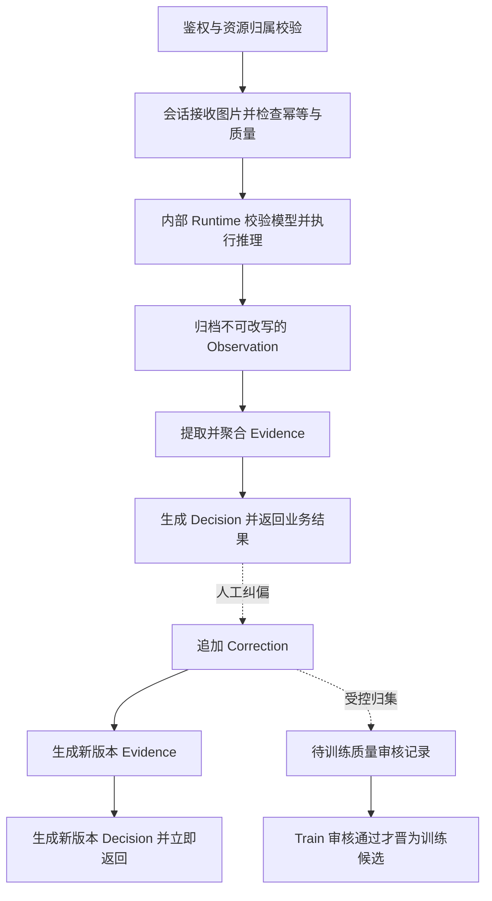

# InferPlatform · 轻眸识刻推理平台与在线业务中枢

> 面向在线业务 API、识别会话、多图编排、证据聚合、标示状态决策与即时人工纠偏的设计仓库

InferPlatform 统一承接 WebClient、MobileClient 与 WxClient 的业务请求。在线业务层负责令牌、资源归属、幂等、图片/会话、推理编排、Evidence、Decision、纠偏和观测审计；本仓内部 `runtime` 模块负责加载模型并输出 Observation。两层逻辑边界保持独立，不新增 Runtime 仓库。

## 当前状态与 M0 边界

现有 8 仓（`.github`、`ProjectPRD`、`TrainPlatform`、`InferPlatform`、`ModelTrain`、`WebClient`、`MobileClient`、`WxClient`）保持不新增、不合并、不重命名，统一处于**设计阶段，M0 待实现**。本文的模块、状态、安全要求和端点都是设计约束，不代表已实现；README 不能证明已有 API、可运行推理服务或发布模型。能力以代码、测试、产物与发布记录为准。

M0 优先验证单机 Web 单图在线切片，不等于完整 C0；多图追加/聚合与完整纠偏审核回流为后续 C0，MobileClient/WxClient 暂停实现但保留原仓。M0 优先创建会话、单图上传与查询三个端点，见下表。可先由 ModelTrain CLI 单机训练并交付候选包，手工执行 Train 职责下的审核与登记；不以前置完成 Train 管理平台、容器/Kubernetes、全部研究、多端或端侧能力扩大 M0 承诺。

## 一、职责与核心模块

| 模块 | 设计职责 |
| :--- | :--- |
| API 与访问控制 | 参数/文件校验、令牌、资源归属、幂等、限流、统一响应与 request_id |
| 会话与图片 | RecognitionSession、图片资产、增量追加、状态与结果查询 |
| 推理编排与适配 | 调用同进程或独立部署的 runtime，校验版本与 Observation，处理超时和不可用 |
| 证据与决策 | 聚合多图 Evidence，按上位日期规则生成 Decision 与复核提示 |
| 纠偏与回流 | 保存 Correction，不覆盖机器观察值；立即生成新证据/决策，归集待训练质量审核记录 |
| 模型激活 | 消费 Train 已授权发布的包，负责 activate / rollback 与 active 指针 |
| 观测审计 | 请求、版本、耗时、失败、纠偏及激活回滚的关联与脱敏留痕 |
| 内部 runtime | 文件/hash/张量校验、preprocess、检测、local OCR、postprocess，产出 Observation |

本仓不组网训练、不做消融或数据集冻结，不执行 Train 的标注质量审核、模型 register / validate / release 治理。ModelTrain 负责离线算法执行，TrainPlatform 管理内部样本、冻结 DatasetVersion、TrainJob、EvalRecord 和 ModelBundle 血缘。

Runtime 可作为同进程模块运行，也可从本仓独立部署；独立部署不改变职责或客户端契约，更不要求新增仓库。Runtime **不维护会话、不聚合 Evidence、不计算 Decision/日期业务状态、不收业务纠偏**；其后处理是模型解码，不是日期期限决策。

## 二、数据流与纠偏

核心实体及 DTO 按 [DATA](https://github.com/QingMouFoodDate/ProjectPRD/blob/main/contracts/DATA.md) 与 [API](https://github.com/QingMouFoodDate/ProjectPRD/blob/main/contracts/API.md) 定义：

| 实体 | 职责 |
| :--- | :--- |
| `RecognitionSession` / `Image` | 同一件食品的多图会话及受控图片引用 |
| `Observation` | Runtime 输出的机器检测与转录，归档后不可被人工改写 |
| `Evidence` | 业务层提取/聚合的结构化事实，保留来源和版本 |
| `Decision` | 根据证据与规则生成的包装标示状态、复核状态及提示 |
| `Correction` | DATA 定义的追加式字段级修正存档，关联原结果、修正值与原因；操作者标识和更完整关联审计属于安全审计规划要求，不是当前 correction.v1 请求或最小存档的既有字段，也不等于训练标签 |



原始 Observation、旧 Evidence 和旧 Decision 保留不覆盖。新增图片重新聚合会话证据；合法纠偏按 `Correction -> 新 Evidence -> 新 Decision` 更新当前会话结果，不修改模型机器结果。业务纠偏立即生效与训练候选资格是两条独立流程，**不能等待训练审核才修正业务结果，也不能因纠偏成功就自动训练**。

Infer 收集待审核记录与受控资产引用；只有 Train 核验来源许可、图像/标注质量和分组后，才能晋为训练候选，并由后续显式流程纳入新冻结版本。

系统只输出包装上的标示状态，不替代食品安全检测，也不判断食品是否绝对安全或适宜食用。日期计算、时区/参考日期、置信度与业务优先规则只引用上位 [DATE_RULES](https://github.com/QingMouFoodDate/ProjectPRD/blob/main/contracts/DATE_RULES.md)，不在 README 自定义。

## 三、输入输出、状态与异常

| 边界 | 输入 | 输出与异常要求 |
| :--- | :--- | :--- |
| 客户端 -> 在线业务层 | 按 API 的创建/查询、图片与纠偏请求，Bearer 令牌、写请求幂等标识 | 会话/结果 DTO 或明确错误；拒绝未授权、越权、不合法文件与幂等冲突 |
| 业务层 -> runtime | 经校验图片、模型版本引用及上位模型约定参数 | Observation 与版本/耗时；哈希、张量、版本不符或推理超时/不可用时失败，不伪造结果 |
| 证据与决策 | 原始 Observation、历史证据及可追溯 Correction | 新 Evidence / Decision；按日期规则区分缺失、冲突与低置信度 |
| 待审核回流 | 修正记录、原始结果、来源授权及受控资产引用 | 待审核记录；Train 审核失败保留原因，不自动晋为候选或发起训练 |

会话处理状态保留 `AWAITING_INPUT`、`RECEIVING_IMAGES`、`PROCESSING`、`PARTIAL_RESULT`、`COMPLETED`、`NEEDS_REVIEW`、`FAILED`、`EXPIRED`，迁移和追加图片/纠偏条件按 API/DATA 校验，不允许失败回调覆盖已更新结果或恢复过期会话。业务 `marked_status` 与 `review_status` 枚举仅引用 DATA，不能与会话处理进度混用。

推理失败不应伪装成 `UNDETERMINED` 或成功形状的响应。部分结果必须明确可用范围和失败/待处理项；超时重试须复用幂等语义，不能重复追加图片、纠偏或决策。已过期资源、版本冲突和纠偏写入失败返回上位错误，不声称纠偏已生效。错误码、HTTP 映射和 DTO 由 API 唯一定义。

## 四、API 与 M0 优先级

下列路径保持不变；表中列出职责与能力级别，不复制请求响应 DTO。

| 端点 | 用途 | 阶段 |
| :--- | :--- | :--- |
| `POST /api/v1/sessions` | 创建识别会话 | C0 / M0 优先 |
| `POST /api/v1/sessions/{session_id}/images` | M0 上传单图；C0 后续追加多图并重新聚合会话证据 | C0 / M0 优先 |
| `GET /api/v1/sessions/{session_id}` | 查询完整会话、证据与当前决策 | C0 / M0 优先 |
| `POST /api/v1/sessions/{session_id}/correction` | 追加纠偏并立即返回更新后的业务决策 | C0 后续，非 M0 前置 |
| `GET /api/v1/models/latest` | 查询受控的端侧模型元数据，不意味着当前 active | C3 预留，非 M0 前置 |

**鉴权与幂等是文档约束，尚未实现**：

- 使用 `Authorization: Bearer <token>`，在线业务层校验有效性、授权范围和到期情况；不在 README 自定义令牌签发/刷新 DTO，不要求企业 SSO。
- 创建会话绑定资源归属；图片、查询和纠偏均校验令牌主体与会话/图片归属，纠偏中的 image_id 也必须属于该会话。知道资源 ID 不构成访问授权。
- 创建会话、上传图片和纠偏等写请求使用 `Idempotency-Key`，键作用域、请求指纹、有效期与冲突响应统一按 API。同键同请求复用原结果，不重复写入或推理；同键不同请求明确拒绝。
- 请求标识与幂等标识不替代身份授权；多图追加返回会话聚合结果，不能仅返回孤立单图识别值。

## 五、模型发布、激活与回滚

统一职责链为 `ModelTrain 候选包 -> Train register / validate / release -> Infer activate / rollback -> 内部 Runtime 执行`。本仓按 [MODEL 的完整必需文件清单](https://github.com/QingMouFoodDate/ProjectPRD/blob/main/contracts/MODEL.md) 消费包，不另建第二棵文件清单，不绕过 Train 治理直接加载算法目录。

- 包的发布状态不等于 active；latest 元数据也不等于当前激活版本。active 是 Infer 的受控运行引用，每次请求记录实际模型版本。
- activate 前校验发布授权、版本、全包 SHA-256、输入输出张量、字典/标签、预后处理配置、Runtime 兼容性及 smoke 结果；加载到隔离候选实例后再切换引用。
- 切换须避免半更新或检测/识别文件混版；**failed switch 保留原 active**，失败记录不能宣称激活成功。无旧 active 且初次加载失败时明确返回不可用。
- 保留授权、兼容且可用的 N-1 旧版与审计引用，支持受控 rollback；回滚同样校验并失败保留原 active。旧版可回滚资格由发布治理决定，已撤销授权/安全禁用的版本不能使用。
- Runtime 只负责已选包的加载与执行，不决定发布资格，不自行选择 latest 或更换 active。

## 六、安全、存储与观测

- HTTPS、参数/上传大小、媒体类型、文件内容与解码检查遵循 API；质量不满足时明确提示补拍，不制造可信观察值。
- 原始图片、模型及元数据使用受控存储；外部 DTO 不含本地路径、数据库结构或部署细节。授权下载使用受控或短期签名引用。
- 令牌、图片、完整敏感文本和用户信息不写入日志；配置与秘密不提交到仓库。Runtime 独立部署时仅开放受控内部调用，不代替客户端业务鉴权。
- 请求/会话、image、Observation、Correction、新旧证据/决策和模型版本可关联审计；记录耗时、失败原因、激活/回滚结果，不能把训练审核与业务纠偏混为同一状态。
- 过期会话、失败任务和临时文件按上位保留策略清理；受审计或冻结资产引用的文件先检查删除保护，不静默破坏血缘。

## 七、提议工程结构与候选技术

以下以 Python 为例，**仅为工程提议，不代表现有文件或已实现能力**：

```text
InferPlatform/                  # 在线业务与内部推理运行时仓库
├── README.md                   # 边界、接口与验收约束
├── requirements.txt            # Python 候选依赖清单
├── .env.example                # 无秘密的配置示例
└── app/                        # 在线服务的提议入口
    ├── api/                    # 路由、令牌、资源归属和幂等
    ├── core/                   # 配置、异常与观测审计
    ├── models/                 # 业务持久化实体和版本关系
    ├── schemas/                # 上位 API 与 DATA 契约适配
    ├── services/               # 会话、图片、推理编排和纠偏
    ├── engine/                 # Evidence 聚合与上位日期规则适配
    ├── activation/             # active 引用、激活与回滚
    ├── runtime/                # 模型校验、预处理、检测、局部 OCR 与后处理
    └── storage/                # 受控资产、保留与删除保护
```

候选路线为 Python FastAPI + SQLAlchemy + Pydantic，或 Go + Gin/Go-Zero + GORM；Runtime 可用 ONNX Runtime，元数据可选 SQLite/PostgreSQL。技术和部署方式是候选，不扩大功能承诺，不改变 API、DTO、日期规则或模型契约。

## 八、上位文档与访问权限

- [需求](https://github.com/QingMouFoodDate/ProjectPRD/blob/main/REQUIREMENTS.md)、[架构](https://github.com/QingMouFoodDate/ProjectPRD/blob/main/ARCHITECTURE.md)、[推进路线](https://github.com/QingMouFoodDate/ProjectPRD/blob/main/ROADMAP.md)
- [API](https://github.com/QingMouFoodDate/ProjectPRD/blob/main/contracts/API.md)、[DATA](https://github.com/QingMouFoodDate/ProjectPRD/blob/main/contracts/DATA.md)、[DATE_RULES](https://github.com/QingMouFoodDate/ProjectPRD/blob/main/contracts/DATE_RULES.md)、[MODEL](https://github.com/QingMouFoodDate/ProjectPRD/blob/main/contracts/MODEL.md)、[TRAINING](https://github.com/QingMouFoodDate/ProjectPRD/blob/main/contracts/TRAINING.md)
- [研究唯一源](https://github.com/QingMouFoodDate/ProjectPRD/blob/main/RESEARCH.md)、[数据质量](https://github.com/QingMouFoodDate/ProjectPRD/blob/main/standards/DATA_QUALITY.md)、[工程规范](https://github.com/QingMouFoodDate/ProjectPRD/blob/main/standards/ENGINEERING.md)
- [ADR-001 八仓职责与在线离线边界](https://github.com/QingMouFoodDate/ProjectPRD/blob/main/decisions/ADR-001-REPOSITORY_BOUNDARIES.md)

ADR-001 已记录批准的职责设计；API/DATA 的令牌、幂等、版本化 DTO 与纠偏待审核语义，以及 MODEL 的完整清单和激活/回滚边界均须在上位契约同步评审。DATE_RULES/TRAINING 的规格由上位文档统一维护；候选引用不表示接口已实现、生产契约已冻结。日期规则与 DTO 不在本仓另行定义。

当前仓库为私有仓库；访问 README、上位文档及 [组织主页](https://github.com/QingMouFoodDate) 的内容取决于登录、组织/仓库授权与主页可见性设置。绝对链接不保证公共可读，未授权时可能不可见；不将敏感资产公开来规避权限。
限。
