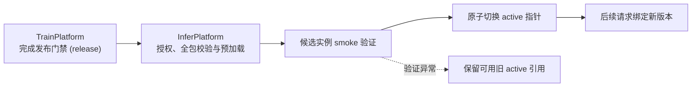

# InferPlatform · 轻眸识刻推理平台与在线业务中枢

> 面向多端统一业务 API、会话生命周期编排、推理运行时集成与即时标示决策的中枢服务仓
>
> **工程状态**：M0 待实现 · 当前仅有 README，无 API、Runtime 或日期引擎代码

InferPlatform 承载在线业务交互与推理服务，面向 WebClient 及后续多端提供统一 RESTful API。平台负责会话编排、安全鉴权、证据聚合、日期推导与人工纠偏即时响应；内部推理运行时（Inference Runtime）负责模型加载、前向计算与观察值生成。

---

## 工程状态与边界说明

| 维度 | 说明 |
| :--- | :--- |
| **当前阶段** | M0 待实现，优先与 WebClient 验证单图识别主链路 |
| **实现范围** | M0 聚焦创建会话、单图上传与结果查询三个端点；多图聚合与业务纠偏随 C0 推进，训练资格由 TrainPlatform 独立审核 |
| **契约基准** | 接口与数据传输模型以 [contracts/API.md](https://github.com/QingMouFoodDate/ProjectPRD/blob/main/contracts/API.md)、[contracts/DATA.md](https://github.com/QingMouFoodDate/ProjectPRD/blob/main/contracts/DATA.md) 与 [openapi.json](https://github.com/QingMouFoodDate/ProjectPRD/blob/main/contracts/openapi.json) 为准 |

项目保留 7 个项目仓库及组织 `.github` 仓，共 8 仓；MobileClient、WxClient 暂缓实现。下文为设计规划，所列模块与目录尚未创建。

---

## 一、平台核心职责与系统边界

### 1. 核心负责内容

- **统一 API 网关**：提供兼容 OpenAPI 3.1 的统一接口，负责参数校验、统一响应与调用链追踪；
- **会话编排与资产管理**：维护 `RecognitionSession` 生命周期，处理图像上传、防重放校验与临时资产索引；
- **推理运行时适配**：内部 `runtime` 加载获授权模型包，执行检测、局部 OCR 与张量解码，将框映射回原图并生成不可变 `Observation`；
- **证据聚合与标示决策**：从机器观察值提取并聚合事实（`Evidence`），依据上位 [日期推导规则](https://github.com/QingMouFoodDate/ProjectPRD/blob/main/contracts/日期推导规则.md) 推导包装标示状态（`Decision`）；
- **即时纠偏响应**：接收客户端字段级人工纠偏，即时生成新版本证据链与决策结论，并受控归集待审数据；
- **模型激活与回滚**：消费 TrainPlatform 授权的标准模型包，隔离验证后切换 `active`，控制 `activate / rollback` 并记录实际版本。

### 2. 系统协作与设计约束

- **算法训练解耦**：不自行编写网络训练或消融实验逻辑，模型训练与调优统一归属 ModelTrain；
- **离线资产解耦**：不承担样本入库审查、标注质量打回与版本切分职责，离线数据与模型发布治理归属 TrainPlatform；
- **判定范围**：系统输出严格限定为“食品包装标示状态”，严禁直接向客户端断言食品绝对可食用等卫生健康结论；
- **推理与业务分层**：Runtime 仅生成机器 `Observation`；会话状态、`Evidence` 提取与 `Decision` 推导由业务层负责。

---

## 二、多端协同矩阵与服务分工

平台优先接入 WebClient，移动与微信端保留后续协同设计：

| 客户端 | 定位 | InferPlatform 支撑职责 |
| :--- | :--- | :--- |
| **WebClient** | 通用 Web 基础端，大创核心验收原型 | 提供在线查验 API、原图边界框与决策 DTO |
| **MobileClient** | 移动端扩展方向，暂缓实现 | 后续接入统一 API、幂等与任务恢复协议 |
| **WxClient** | 微信生态入口，暂缓实现 | 后续评审轻量响应、大字视图与卡片分享数据 |

平台与客户端的各核心能力分工如下：

| 能力 | 客户端目标职责 | InferPlatform 核心职责 |
| :--- | :--- | :--- |
| 图像采集与交互引导 | 客户端负责拍摄与引导 | 不参与客户端交互 |
| 识别会话与防重放上传 | 携带幂等键发起请求 | 维护生命周期与资产索引 |
| 视觉检测与文字转录 | 接收 Observation 并呈现 | 内部 Runtime 执行模型推理 |
| 包装标示状态语义推导 | 接收 Decision 并展示 | 依据日期推导规则计算决策 |
| 字段级人工纠偏流转 | 提交修正字段与原因 | 即时重算决策并归集待审资产 |
| 模型激活与版本调度 | 消费在线稳定版本 | 控制 active 指针与安全回滚 |


---

## 三、在线业务数据流与纠偏闭环


---

## 四、核心领域实体与数据模型

实体及字段遵循上位 [DATA](https://github.com/QingMouFoodDate/ProjectPRD/blob/main/contracts/DATA.md)，原图与机器观察值保留，修正和重算派生新版本：

| 实体名称 | 设计职责 |
| :--- | :--- |
| `RecognitionSession` | M0 单图识别会话，维护生命周期与资源归属，后续扩展同一食品的多图上下文 |
| `Observation` | 机器原生视觉感知结果（检测框、OCR 文本与置信度），归档后不可变 |
| `Evidence` | 业务层提取与聚合的结构化事实，记录机器来源与版本引用 |
| `Decision` | 分别呈现期限与复核状态；新候选 decision.v2 用 calculation_profile_id 关联不可变计算依据与配置 |
| `Correction` | 追加式存档合法 `correction.v1` 请求及其引用，字段以 DATA 定义为准 |

事实均引用本会话真实 Image；MODEL 引用 Observation，局部 `source_box_id` 指向真实框，全局文字可为 `null`。MANUAL 的 `confidence` 为 `null`，`source_correction_id` 指向合法 Correction；可保留相关观察和框的真实引用，也可为空。

新日期候选采用 date-rules.v2：可靠直接 EXP 可独立比较期限，M0 默认候选为可配置的 30 天固定临期阈值，不因缺 MFG 阻断剩余超过阈值的在期结果；寿命比例策略留待后续评审，阈值不是法定标准。无直接 EXP 且派生起算依据未知时，不猜日期，输出 UNDETERMINED / INFORMATION_MISSING 并提示补充到期日或起算依据。

直接与派生日期差一天先核对来源和起算口径；确认同一期限、同一口径仍不一致时保留冲突。MFG = EXP 不一概判错，须核对同日起算等依据；MFG > EXP 或未来生产日期按必要事实规则检查。API、DATA 与 Schema 统一升级后接入 decision.v2，不混用载荷；v1 记录沿用历史规则，新判断保留原证据并生成新版本。date-rules.v2 判定引擎已通过 28 组测试向量（V01~V28）100% 实测验证。

离线主基准库已完成全量肉眼审判并冻结 1617 张样本（8:1:1 科学分层划分：Train 1293, Val 162, Test 162，另沉淀 701 张原始采图与 56 张冗余简单隔离样本）；资产进度见 [DATA 第二节](https://github.com/QingMouFoodDate/ProjectPRD/blob/main/contracts/DATA.md#二离线-sampleasset)，在线 Image 与离线 SampleAsset 保持严格物理隔离。

---

## 五、核心 API 契约与演进阶段

平台对外暴露的端点严格映射 OpenAPI 3.1 契约规范：

| 接口端点与方法 | 功能职责 | 规划演进阶段 |
| :--- | :--- | :--- |
| `POST /api/v1/sessions` | 创建识别会话，签发短期不透明 `session_token` | M0 优先核心链路 |
| `POST /api/v1/sessions/{session_id}/images` | 上传单张图片，返回完整 Observation、Evidence 与 Decision | M0 单图；C0 扩展多图 |
| `GET /api/v1/sessions/{session_id}` | 查询已存会话状态与完整安全 DTO | M0 优先核心链路 |
| `POST /api/v1/sessions/{session_id}/correction` | 提交字段级人工修正并即时刷新当前决策 | C0 阶段核心功能 |
| `GET /api/v1/models/latest` | 独立授权查询适配目标平台的 released 包元数据，latest 不等于 active | C3 阶段远期预留 |

会话访问以 Bearer 凭证验证归属，令牌不进入 URL 或日志。GET 只读已存结果，不回传令牌或按查询时钟重算。

创建、上传与纠偏分别使用幂等键。同键同请求返回原结果，同键异请求返回 409；M0 先判断上传重放，原键重放返回首次结果，新键追加第二图返回 409。并发与迟到结果不覆盖新版本。

M0 使用 `AWAITING_INPUT / PROCESSING / COMPLETED / NEEDS_REVIEW / FAILED / EXPIRED` 六状态。合法无检出可返回空检测；模型不可用、超时或非法输出属技术失败，不得伪装成空检测。必要日期事实缺失、冲突或低置信时无法判定并复核；非必要保存条件问题仅记 `warnings`。研究策略选择复核也属于合法业务结果，保留 Evidence、Decision 与 guidance；FAILED 用于技术执行失败，不用于策略性拒识。

当前 `correction.v1` 仅支持 `mfg_date / exp_date / shelf_life / storage_condition`。完整 C0 保留 OCR 原文与框修正目标，须扩展契约后接入。合法修正追加 Correction 与新版 Evidence/Decision，保留原观察与历史；业务重算不等待训练审核。

---

## 六、模型激活与安全回滚机制

模型在在线环境的生效受限于跨仓治理链路：



- 发布授权不等于 active；核验外部授权、完整包哈希、张量、字典与配置，隔离加载并通过 smoke 后切换，细节见 [MODEL](https://github.com/QingMouFoodDate/ProjectPRD/blob/main/contracts/MODEL.md)；
- 每次请求绑定完整 `model_version`：切换前请求沿用原包，后续请求绑定新包；Observation 记录实际版本，历史 Decision 不重算；
- 加载、验证或切换失败保留可用旧 active；无可用 active 时返回 `INFERENCE_UNAVAILABLE`。回滚重新核验旧包授权、完整性与兼容性。

---

## 七、提议工程目录结构

M0 采用单机与受控存储，TrainPlatform 可手工治理；独立 worker、Redis 与 Kubernetes 等为后续候选，按实测需求评审。

```text
InferPlatform/                  # 在线业务与推理运行时仓库
├── README.md                   # 在线服务定位、接口与架构说明
├── requirements.txt            # Python 核心依赖清单
├── .env.example                # 基础运行环境配置参考
└── app/                        # 业务应用核心逻辑
    ├── api/                    # 路由网关、鉴权控制与幂等拦截
    ├── core/                   # 全局配置、异常处理与审计监控
    ├── models/                 # 持久化实体与关系映射
    ├── schemas/                # 上位 API 与 DATA 数据传输对象
    ├── services/               # 会话生命周期与纠偏处理服务
    ├── engine/                 # 证据聚合与日期规则推导
    ├── activation/             # 模型生命周期热加载与安全回滚
    ├── runtime/                # 内部推理引擎、检测与局部 OCR 适配
    └── storage/                # 临时图像资产管理与受控访问
```

---

## 八、相关文档

- [需求规格](https://github.com/QingMouFoodDate/ProjectPRD/blob/main/需求规格.md)
- [系统架构](https://github.com/QingMouFoodDate/ProjectPRD/blob/main/系统架构.md)
- [开发路线](https://github.com/QingMouFoodDate/ProjectPRD/blob/main/开发路线.md)
- [API 接口契约](https://github.com/QingMouFoodDate/ProjectPRD/blob/main/contracts/API.md)
- [数据模型](https://github.com/QingMouFoodDate/ProjectPRD/blob/main/contracts/DATA.md)
- [模型交付规约](https://github.com/QingMouFoodDate/ProjectPRD/blob/main/contracts/MODEL.md)
- [日期推导规则](https://github.com/QingMouFoodDate/ProjectPRD/blob/main/contracts/日期推导规则.md)
- [工程协作指南](https://github.com/QingMouFoodDate/ProjectPRD/blob/main/standards/工程协作指南.md)
- [数据质量规范](https://github.com/QingMouFoodDate/ProjectPRD/blob/main/standards/数据质量规范.md)
- [Decision v2 候选结构](https://github.com/QingMouFoodDate/ProjectPRD/blob/main/contracts/schemas/decision.v2.schema.json)与[历史 v1 日期规则](https://github.com/QingMouFoodDate/ProjectPRD/blob/main/contracts/archive/日期推导规则.v1.md)
- [研究现状](https://github.com/QingMouFoodDate/ProjectPRD/blob/main/references/研究现状.md)


