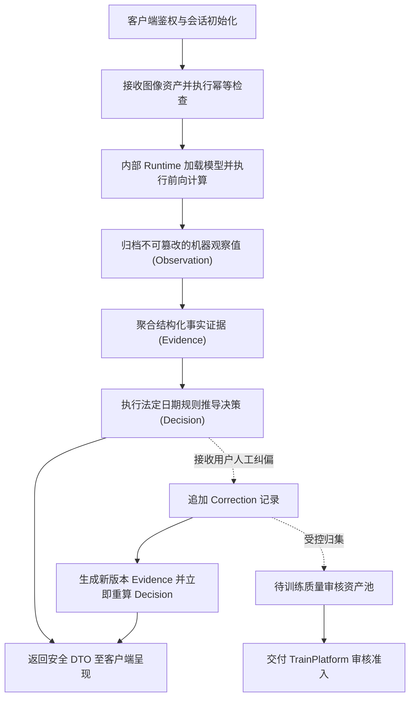
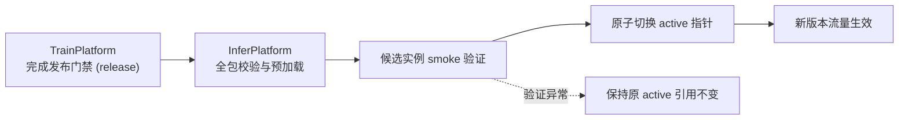

# InferPlatform · 轻眸识刻推理平台与在线业务中枢

> 面向多端统一业务 API、会话生命周期编排、推理运行时集成与即时标示决策的中枢服务仓
>
> **工程状态**：在线中枢架构设计就绪 · M0 单图闭环推进中 · 内部集成 Inference Runtime · 离线治理对接 TrainPlatform

InferPlatform 承载在线业务交互与推理服务，为 WebClient、MobileClient 与 WxClient 提供统一 RESTful API。平台负责会话编排、安全鉴权、证据聚合、日期推导与人工纠偏即时响应；内部集成推理运行时（Inference Runtime）负责模型加载与前向计算。

---

## 工程状态与边界说明

| 维度 | 说明 |
| :--- | :--- |
| **当前阶段** | 处于架构规范与 M0 核心原型攻坚阶段，优先拉通 Web 单图识别验证主链路 |
| **实现范围** | M0 阶段聚焦创建会话、单图上传与结果查询三个核心端点；多图聚合比对与纠偏审核流随 C0 演进 |
| **契约基准** | 通信接口与数据传输模型严格受限于上位 [在线接口契约](../ProjectPRD/contracts/在线接口契约.md)、[核心数据模型](../ProjectPRD/contracts/核心数据模型.md) 与 [openapi.json](../ProjectPRD/contracts/openapi.json) |

---

## 一、平台核心职责与系统边界

### 1. 核心负责内容

- **统一 API 网关**：提供兼容 OpenAPI 3.1 的统一接口，负责参数校验、统一响应与调用链追踪；
- **会话编排与资产管理**：维护 `RecognitionSession` 生命周期，处理图像上传、防重放校验与临时资产索引；
- **推理运行时适配**：内部 `runtime` 模块加载通过门禁的标准模型包，执行检测与局部识别并生成不可变机器观察值（`Observation`）；
- **证据聚合与标示决策**：聚合机器观察事实（`Evidence`），依据上位 [日期推导规则](../ProjectPRD/contracts/日期推导规则.md) 推导包装标示状态（`Decision`）；
- **即时纠偏响应**：接收客户端字段级人工纠偏，即时生成新版本证据链与决策结论，并受控归集待审数据；
- **模型激活与回滚**：消费 TrainPlatform 批准的标准模型包，执行运行时热加载激活（`activate`）与安全回滚（`rollback`）。

### 2. 系统协作与设计约束

- **算法训练解耦**：不自行编写网络训练或消融实验逻辑，模型训练与调优统一归属 ModelTrain；
- **离线资产解耦**：不承担样本入库审查、标注质量打回与版本切分职责，离线数据与模型发布治理归属 TrainPlatform；
- **法定标示受限**：系统输出严格限定为“食品包装标示状态”，严禁直接向客户端断言食品绝对可食用等卫生健康结论；
- **推理与业务分层**：内部 Runtime 仅负责计算物理检测框与转录文本，不维护会话状态，不直接推导保质期业务结论。

---

## 二、多端协同矩阵与服务分工

平台面向全域多端提供差异化的服务能力支撑：

| 客户端名称 | 客户端形态与定位 | InferPlatform 支撑职责 |
| :--- | :--- | :--- |
| **WebClient** | 通用 Web 基础端，大创核心验收原型 | 提供在线查验 API、原图边界框与决策 DTO |
| **MobileClient** | 移动端扩展方向，具备传感器辅助能力 | 提供高可用 API、幂等支持与离线任务恢复凭据 |
| **WxClient** | 微信生态免安装入口，面向适老与分享 | 提供轻量化响应，支持大字视图数据抽取与卡片分享数据 |

| 核心能力单元 | 客户端目标职责 | InferPlatform 核心职责 |
| :--- | :--- | :--- |
| 图像采集与交互引导 | 客户端负责拍摄与引导 | 不参与客户端交互 |
| 识别会话与防重放上传 | 携带幂等键发起请求 | 维护生命周期与资产索引 |
| 视觉检测与文字转录 | 接收 Observation 并呈现 | 内部 Runtime 执行模型推理 |
| 包装标示状态语义推导 | 接收 Decision 并展示 | 依据法定日期规则计算决策 |
| 字段级人工纠偏流转 | 提交修正字段与原因 | 即时重算决策并归集待审资产 |
| 模型激活与版本调度 | 消费在线稳定版本 | 控制 active 指针与安全回滚 |

---

## 三、在线业务数据流与纠偏闭环



---

## 四、核心领域实体与数据模型

平台采用上位数据契约标准，实现高内聚的数据实体流转：

| 实体名称 | 设计职责 |
| :--- | :--- |
| `RecognitionSession` | 识别会话单元，维护同一食品的多图上下文与安全凭据 |
| `Observation` | 机器原生视觉感知结果（检测框、OCR 文本与置信度），归档后不可变 |
| `Evidence` | 业务层提取与聚合的结构化事实，记录机器来源与版本引用 |
| `Decision` | 最终呈现的包装标示状态与独立复核指引，由法定日期规则驱动 |
| `Correction` | 追加式字段级人工纠偏记录，捕获原值、修正值与修正理由 |

---

## 五、核心 API 契约与演进阶段

平台对外暴露的端点严格映射 OpenAPI 3.1 契约规范：

| 接口端点与方法 | 功能职责 | 规划演进阶段 |
| :--- | :--- | :--- |
| `POST /api/v1/sessions` | 创建识别会话，签发安全 `session_token` | M0 优先核心链路 |
| `POST /api/v1/sessions/{session_id}/images` | 上传单张/多张图片，触发推理与证据聚合 | M0 优先核心链路 |
| `GET /api/v1/sessions/{session_id}` | 查询会话最新状态，拉取完整安全 DTO | M0 优先核心链路 |
| `POST /api/v1/sessions/{session_id}/correction` | 提交字段级人工修正并即时刷新当前决策 | C0 阶段核心功能 |
| `GET /api/v1/models/latest` | 查询受控端侧模型元数据 | C3 阶段远期预留 |

---

## 六、模型激活与安全回滚机制

模型在在线环境的生效受限于跨仓治理链路：



- 切换模型前须对全包 SHA-256、张量维度、字典一致性与本地 smoke 用例执行完整校验；
- 加载异常触发原子保护，旧版本服务不中断；支持快速回滚至经受控授权的 N-1 版本。

---

## 七、提议工程目录结构

```text
InferPlatform/                  # 在线业务与推理运行时仓库
├── README.md                   # 在线服务定位、接口与架构说明
├── requirements.txt            # Python 核心依赖清单
├── .env.example                # 基础运行环境配置参考
└── app/                        # 业务应用核心逻辑
    ├── api/                    # 路由网关、鉴权控制与幂等拦截
    ├── core/                   # 全局配置、异常处理与审计监控
    ├── models/                 # 持久化实体与关系映射
    ├── schemas/                # 上位 API 与 DATA 数据传输对象
    ├── services/               # 会话生命周期与纠偏处理服务
    ├── engine/                 # 证据聚合与法定日期规则推导
    ├── activation/             # 模型生命周期热加载与安全回滚
    ├── runtime/                # 内部推理引擎、检测与局部 OCR 适配
    └── storage/                # 临时图像资产管理与受控访问
```

---

## 八、权威依据与参考文档

| 规范维度 | 事实源契约 | 核心约束说明 |
| :--- | :--- | :--- |
| **系统设计与规划** | [需求规格](../ProjectPRD/需求规格.md) · [系统架构](../ProjectPRD/系统架构.md) · [开发路线](../ProjectPRD/开发路线.md) | 确立系统功能边界、8 仓架构分层与 M0 迭代里程碑 |
| **跨仓技术契约** | [在线接口契约](../ProjectPRD/contracts/在线接口契约.md) · [核心数据模型](../ProjectPRD/contracts/核心数据模型.md) · [openapi.json](../ProjectPRD/contracts/openapi.json) | 统一会话编排、REST 接口端点定义与 Observation/Evidence 数据模型 |
| **规则与执行契约** | [日期推导规则](../ProjectPRD/contracts/日期推导规则.md) · [模型交付规约](../ProjectPRD/contracts/模型交付规约.md) | 包装标示状态法定决策逻辑与标准模型包交付规约 |
| **工程与质量规范** | [工程协作指南](../ProjectPRD/standards/工程协作指南.md) · [数据质量规范](../ProjectPRD/standards/数据质量规范.md) | 跨仓协作开发规范、分支流转与样本质量红线 |

